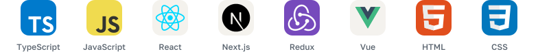
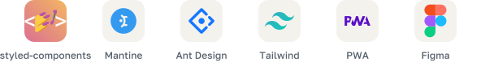

  

## 👨‍💻 Обо мне

Fullstack-разработчик. Делаю внутреннее PWA-приложение, которым каждый день пользуются больше 200 сотрудников: фронтенд на Next.js, бэкенд на NestJS. Веду фичи целиком: разбираю требования, проектирую архитектуру, пишу клиент и сервер и выкатываю в production.

## 🚀 Что я сделал для сотрудников

- **Графики смен.** Готовые шаблоны вроде 5/2 и свои правила заполнения. Можно отдать модели xlsx-файл, и она сама заполнит график и соберёт выгрузку: интеграция сделана на Model Context Protocol.
- **QR-сканер**, который открывает двери прямо из приложения.
- **Диктофон.** Запись уходит в ИИ, обратно приходит краткое содержание.
- **Чат техподдержки** внутри приложения. Он работает на Pyrus, а безопасность интеграции обеспечивает отдельный BFF-слой.

## ⚙️ Что под капотом

- Предложил и провёл переезд на **Next.js 16** и **React Compiler**. Часть модулей стала быстрее на 20–30%.
- Уменьшил бандл, убрал лишние перерисовки, настроил offline-режим.
- Покрыл код тестами: unit на **Vitest**, e2e на **Playwright**.
- Завёл spec-driven разработку на **OpenSpec** и написал инструкции для ИИ-агентов, чтобы сгенерированный код не ломал архитектуру.
- Собрал шаблон фронтенд-приложения, с которого стартуют новые проекты.
- Пишу эндпоинты и бизнес-логику на **NestJS** и **TypeORM**, отдельные сервисы на **Bun** и **Hono**.

## 🧰 Стек

**Frontend**

<picture>
  <source media="(prefers-color-scheme: dark)" srcset="assets/stack-frontend-dark.svg" />
  
</picture>

**UI**

<picture>
  <source media="(prefers-color-scheme: dark)" srcset="assets/stack-ui-dark.svg" />
  
</picture>

**Backend**

<picture>
  <source media="(prefers-color-scheme: dark)" srcset="assets/stack-backend-dark.svg" />
  
</picture>

**Тесты и инструменты**

<picture>
  <source media="(prefers-color-scheme: dark)" srcset="assets/stack-tools-dark.svg" />
  
</picture>

## 📊 Статистика

  
  

