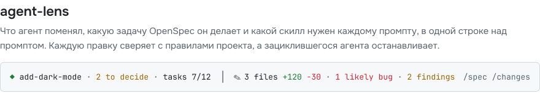
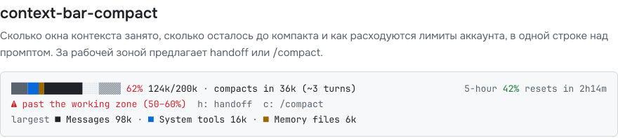
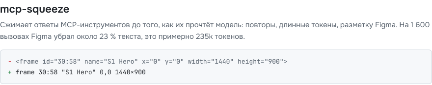
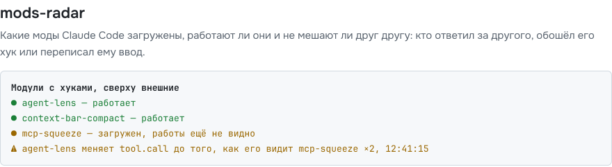
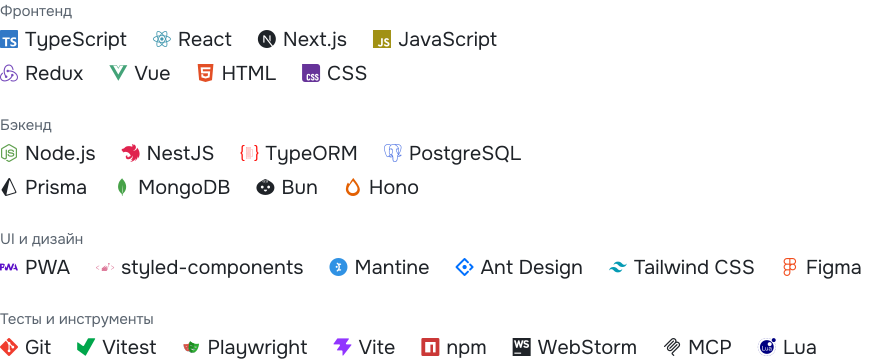

<a href="https://t.me/abobaid">
<picture>
  <source media="(prefers-color-scheme: dark)" srcset="assets/hero-dark.svg" />
  
</picture>
</a>

## Обо мне

Fullstack-разработчик. Сейчас делаю внутреннее PWA-приложение для сотрудников компании: фронт на Next.js, бэк на NestJS. Задачи беру целиком: обсуждаю требования, пишу интерфейс и API, довожу до релиза.

## Чем занимаюсь

Пишу веб-приложения целиком, от интерфейса до API и базы. Люблю пробовать новые технологии и разбираться, как они устроены. Сейчас много изучаю разработку с ИИ: пишу правила и инструкции для агентов, подключаю инструменты через MCP, веду фичи по спекам в OpenSpec. Ещё копаюсь в производительности фронтенда, от размера бандла до лишних ререндеров и офлайн-режима.

## Моды для Claude Code

Строки над промптом и панели, по которым видно, что делает агент и куда уходит контекст.

<a href="https://github.com/Darvl-52/agent-lens">
  <picture>
    <source media="(prefers-color-scheme: dark)" srcset="assets/mod-agent-lens-dark.svg" />
    
  </picture>
</a>
  
<a href="https://github.com/Darvl-52/context-bar-compact">
  <picture>
    <source media="(prefers-color-scheme: dark)" srcset="assets/mod-context-bar-compact-dark.svg" />
    
  </picture>
</a>
  
<a href="https://github.com/Darvl-52/mcp-squeeze">
  <picture>
    <source media="(prefers-color-scheme: dark)" srcset="assets/mod-mcp-squeeze-dark.svg" />
    
  </picture>
</a>
  
<a href="https://github.com/Darvl-52/mods-radar">
  <picture>
    <source media="(prefers-color-scheme: dark)" srcset="assets/mod-mods-radar-dark.svg" />
    
  </picture>
</a>

## Стек

<picture>
  <source media="(prefers-color-scheme: dark)" srcset="assets/stack-dark.svg" />
  
</picture>
